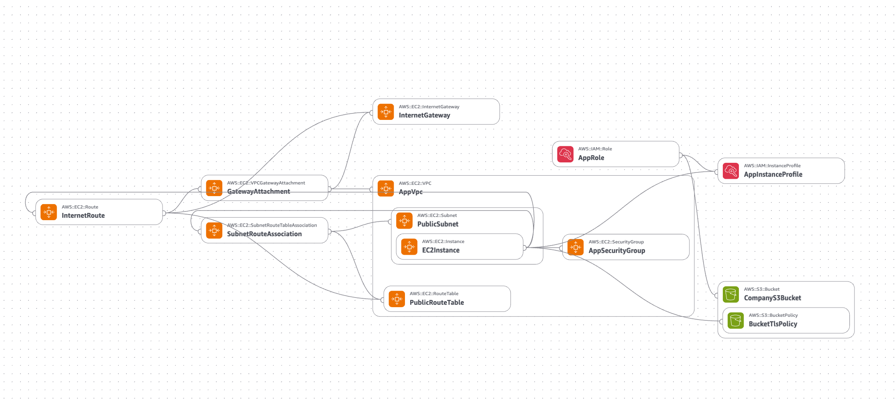

# AWS Automated Web Deployment

A learning project that uses CloudFormation to create AWS infrastructure for a TypeScript file-upload application. The goal is to make the environment repeatable and give EC2 access to S3 without storing AWS credentials in the code.

## Architecture Diagram



## How it works

```text
Browser → Express app on EC2 → Private S3 bucket
```

- The browser lets you select and upload one file up to 5 MiB.
- Express and Multer receive the file, then the AWS SDK uploads it to S3.
- S3 object names use Multer-generated filenames under the configured prefix.
- Temporary files are removed after the upload attempt.
- EC2 uses an IAM role with upload permission for that bucket prefix.

Built with TypeScript, Node.js, Express, Multer, Axios, and AWS CloudFormation.

## Current progress

The application and infrastructure template are implemented. An upload from the local application to S3 has been verified successfully. Application uploads from EC2 using its IAM role still need to be verified.

CloudFormation creates the network, EC2, S3, and IAM resources. User Data installs Git and downloads the repository. **Installing Node.js, configuring the application, and starting it are still manual.** Full application startup automation is a later step.

## Manual setup on your local machine

### 1. Install dependencies

You need Node.js 22, npm, AWS CLI v2.32.0 or newer, and an existing S3 bucket. You can create the bucket through the [CloudFormation setup](infra/README.md).

From the project directory containing `package.json`:

```bash
npm install
```

### 2. Sign in to AWS

Create or sign in to a local profile using your browser:

```bash
aws login --profile local-dev
```

When prompted for a region, enter the region where your bucket was created. Complete the browser sign-in, then check your identity:

```bash
aws sts get-caller-identity --profile local-dev
```

Your signed-in identity needs `s3:PutObject` permission for your bucket's upload prefix. Sign-in does not grant permissions. IAM users and roles may also need `SignInLocalDevelopmentAccess` for this login method. If you use IAM Identity Center, configure an SSO profile with `aws configure sso --profile local-dev`, then sign in with `aws sso login --profile local-dev` instead.

The CLI and SDK use temporary credentials; do not put access keys in the code or `.env`. See [AWS's local sign-in guide](https://docs.aws.amazon.com/cli/latest/userguide/cli-configure-sign-in.html) for login prerequisites.

### 3. Configure the application

If you do not already have a `.env` file, copy the example:

```bash
cp .env.example .env
```

Edit it with your actual bucket name and region:

```dotenv
PORT=8000
AWS_REGION=eu-west-2
S3_BUCKET_NAME=your-bucket-name
S3_UPLOAD_PREFIX=uploads
```

`eu-west-2` is an example. **`AWS_REGION` must match the bucket's actual region**, which you can check in S3 → your bucket → Properties. Get the bucket name from your stack's `BucketName` output. Keep `.env` out of Git.

### 4. Start the server and upload

```bash
AWS_PROFILE=local-dev npm run dev
```

Open **http://localhost:8000**, select a file up to 5 MiB, and click **Upload file**. Use port 8000 rather than Live Server's port 5500 so requests reach Express.

A successful upload returns a confirmation and an object key. Check the bucket's `uploads/` prefix in the S3 console. The local temporary file is removed after the upload attempt.

### Common errors

- **405 on port 5500:** open `http://localhost:8000` instead.
- **Could not load credentials:** sign in again and start the app with `AWS_PROFILE=local-dev`.
- **PermanentRedirect:** correct `AWS_REGION` to match the bucket, stop the server with Ctrl+C, and restart it.
- **AccessDenied:** check that your local signed-in identity can upload to this bucket and prefix.

Restart the server after changing `.env`. Local authentication is separate from EC2: the deployed app uses its attached IAM role instead of your laptop's profile.

## Endpoints

| Method | Path             | Purpose                                               |
| ------ | ---------------- | ----------------------------------------------------- |
| GET    | `/`              | Upload page                                           |
| GET    | `/health`        | Check that the server responds                        |
| PUT    | `/api/v1/upload` | Upload a file using the `upload_file` multipart field |

## Deploy to AWS

Follow the [infrastructure guide](infra/README.md) to create the stack and set up the application on EC2.

## Tests

```bash
npm test
```

Vitest runs the upload and browser logic tests. Use `npm run test:watch` during development. Tests use mocked S3 calls. They do not verify real AWS permissions or deployment.

## Next steps

- Verify browser uploads on EC2 and confirm the objects in S3.
- Demonstrate permitted and denied operations using the EC2 role.
- Configure systemd, then automate application installation and startup.
- Demonstrate a CloudFormation update and successful stack cleanup.
- Add screenshots and lessons learned.

This is a learning environment. Authentication, downloads, and an HTTPS application endpoint are not implemented yet.
