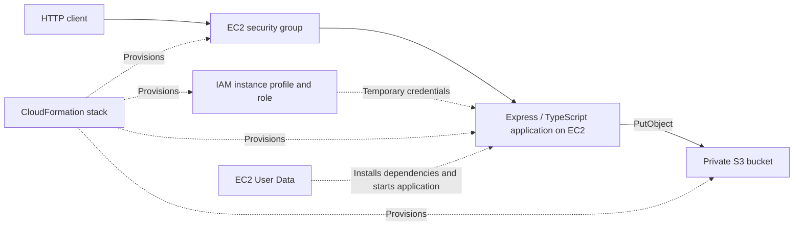

# Automated Web Application Deployment on AWS

A TypeScript web application being developed into a repeatable AWS environment using CloudFormation, EC2, IAM, and S3.

The project addresses a common infrastructure problem: deploying an application through manual console configuration is difficult to reproduce, review, and maintain. The intended outcome is a version-controlled infrastructure definition that provisions the environment, bootstraps the application, and grants it narrowly scoped access to cloud storage.

**Status: application and infrastructure template implemented; AWS deployment verification pending.** Successful S3 uploads and deployment to AWS have not yet been verified.

## Project objectives

- Provision the application environment through CloudFormation.
- Run a Node.js application on EC2, with dependencies and startup configured through User Data.
- Store application files in a private S3 bucket.
- Authenticate from EC2 through an IAM role and instance profile, using temporary credentials.
- Demonstrate deployment, a controlled infrastructure update, and cleanup through a documented workflow.

## Current implementation

| Component | Implementation | Verification status |
| --- | --- | --- |
| HTTP application | Express with TypeScript and ES modules | Local server startup reported |
| Homepage | `GET /` returns a welcome page | Implemented; no automated check recorded |
| Health endpoint | `GET /health` returns a basic server response | Implemented; no automated check recorded |
| Upload endpoint | `PUT /api/v1/upload` reads a local sample image and sends an S3 `PutObjectCommand` | Request reached the SDK; blocked by missing local credentials |
| AWS authentication | No credentials supplied in application code; SDK uses its default credential providers | Successful authentication pending |
| Infrastructure | Dedicated network, EC2 startup, S3, and IAM in `infra/setup.yaml` | Local schema validation passed; AWS deployment pending |

## Architecture

The target architecture is shown below. AWS resources in this diagram are defined in the template; the diagram is not evidence of a completed deployment.



The current local request flow is:

```text
PUT /api/v1/upload
  → routes/index.ts
  → routes/user.ts
  → controller/user.ts
  → config/s3Client.ts
  → read sample image from disk
  → send PutObjectCommand to S3
```

## Technology choices

| Technology | Purpose |
| --- | --- |
| Node.js and TypeScript | Application runtime and static type checking |
| Express 5 | HTTP routing and responses |
| AWS SDK for JavaScript v3 | S3 operations through `S3Client` and `PutObjectCommand` |
| dotenv | Local environment configuration |
| tsx | Development execution with automatic restart |
| CloudFormation, EC2, IAM, S3 | Infrastructure provisioning, application hosting, permissions, and storage |

## Repository layout

```text
app.ts                         Application setup, homepage, and health route
config/s3Client.ts             Reusable S3 upload helper
controller/user.ts             Upload request handler
routes/index.ts                API route mounting
routes/user.ts                 Upload route definition
public/assets/img/hiyaaa.webp   Sample file used by the upload handler
infra/setup.yaml               Complete infrastructure template
infra/README.md                Deployment, verification, updates, and cleanup
tsconfig.json                  TypeScript configuration
```

## Run locally

Run the following commands from this project's directory, which contains `package.json`.

### 1. Install dependencies

```bash
npm install
```

`tsx` is included as a runtime dependency so both development and EC2 can run TypeScript. If you want to run the TypeScript compiler for separate type checking, install these development tools:

```bash
npm install --save-dev typescript @types/node
```

### 2. Configure the application port

Create a local `.env` file:

```dotenv
PORT=8000
AWS_REGION=eu-west-2
S3_BUCKET_NAME=YOUR_EXISTING_BUCKET
S3_UPLOAD_PREFIX=uploads
```

The application currently reads its port from `PORT` without a default. The `.env` file is excluded from version control.

### 3. Start the development server

```bash
npm run dev
```

The project uses extensionless relative imports with TypeScript's `Bundler` module resolution. Run it through `tsx` using the development script. Plain `node app.ts` currently fails to resolve those imports. TypeScript is configured with `noEmit: true`, so it does not produce a compiled `dist` directory.

### 4. Check the HTTP routes

```bash
curl -i http://localhost:8000/
curl -i http://localhost:8000/health
```

The expected health response is HTTP `200` with the body `Server is ok.` This endpoint checks that the application responds; it does not check S3 access.

## Test the S3 integration

The current upload handler uses these development values:

| Setting | Current value | Location |
| --- | --- | --- |
| Region | `AWS_REGION`, defaulting to `eu-west-2` | `config/s3Client.ts` |
| Bucket | Required `S3_BUCKET_NAME` | `controller/user.ts` |
| Object key | `${S3_UPLOAD_PREFIX}/test-key-123`, defaulting to `uploads/test-key-123` | `controller/user.ts` |
| Source file | `./public/assets/img/hiyaaa.webp` | `controller/user.ts` |

The bucket must exist and the active AWS identity must have permission to write to the specified object. CloudFormation generates a unique bucket name and supplies it to EC2 together with the region and upload prefix. For local testing, set these values in your environment.

Configure a local AWS profile and sign in using the authentication method appropriate to your AWS account. For an existing IAM Identity Center profile, for example:

```bash
aws sso login --profile YOUR_PROFILE
aws sts get-caller-identity --profile YOUR_PROFILE
```

Start the application with that profile selected:

```bash
AWS_PROFILE=YOUR_PROFILE npm run dev
```

Then send the upload request:

```bash
curl -i -X PUT http://localhost:8000/api/v1/upload
```

Expected application responses:

- Success: HTTP `200` with `{"message":"Upload successful"}`.
- Failure: HTTP `500` with an error message.

The endpoint currently uploads the fixed sample file from the server's filesystem. It does not accept a file in the request body. Running from the project directory matters because the source path is relative to the working directory. Repeated successful requests use the same S3 key rather than generating distinct object names.

### Authentication boundary

Locally, the SDK uses available credentials such as a selected AWS profile. On EC2, the intended credential source is the instance's IAM role. Deploying a role through CloudFormation does not automatically authenticate an application running on a laptop.

The observed `CredentialsProviderError: Could not load credentials from any providers` confirms that execution reached credential resolution. It does not verify a successful S3 upload, bucket existence, or sufficient permissions.

## Infrastructure deployment

The template defines a dedicated VPC and public subnet, restricted application security group, encrypted private S3 bucket, upload-only EC2 role, instance profile, and Amazon Linux 2023 EC2 instance. User Data installs the application from a pinned public GitHub commit and starts it under systemd. After deployment, check `/health` yourself: stack completion does not verify that the application started successfully.

See the [deployment guide](infra/README.md) for prerequisites, one-command provisioning, role verification, infrastructure updates, troubleshooting, and object/stack cleanup. Commit and push the deployment changes before using their source revision.

The environment is a single-instance HTTP demonstration. Application releases currently use a new stack; changing User Data alone does not redeploy code on an existing instance.

## Validation and evidence roadmap

- [x] Implement homepage and health routes.
- [x] Separate API routing, controller logic, and the S3 helper.
- [x] Implement a sample upload operation without embedding AWS credentials.
- [x] Exercise the upload path locally and identify the missing-credentials blocker.
- [ ] Verify a successful upload and confirm the object in S3.
- [x] Implement the CloudFormation template and pass local schema validation.
- [ ] Deploy the complete environment with one documented command.
- [ ] Verify uploads from EC2 using the attached role.
- [ ] Demonstrate that access outside the permitted S3 scope is denied.
- [ ] Demonstrate a controlled CloudFormation update.
- [ ] Verify application startup after an EC2 reboot.
- [ ] Document object cleanup and delete the stack successfully.
- [ ] Add deployment evidence, a final architecture diagram, and lessons learned.

## Current limitations

- AWS deployment and successful storage access remain unverified.
- The upload endpoint uses a fixed server-side file and object name; bucket and upload prefix are configured through the environment.
- The upload endpoint has no application-level authentication or file validation yet.
- Error responses currently include raw error text; response sanitization is planned before public deployment.
- There is no automated test suite; `npm test` is still the generated placeholder and exits with an error.
- systemd startup is defined in User Data but has not been verified on EC2. HTTPS, high availability, and automated application releases remain future work.

## Portfolio evidence to add

As each milestone is completed, this README will be updated with reproducible commands and evidence: stack outputs, application responses, an uploaded object, permission checks, an infrastructure update, and successful cleanup. Account identifiers and sensitive information should be redacted from shared screenshots and logs.

The completed project should demonstrate infrastructure as code, application bootstrapping, role-based AWS access, least-privilege permissions, and ownership of the full deployment lifecycle.
